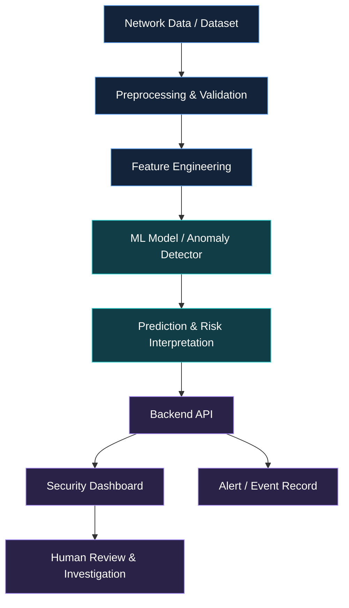

<!-- AI-Based Early Cyber Attack Prediction System -->

<div align="center">


### 🛡️ Predict Earlier. Investigate Smarter. Defend Proactively.

An AI-driven cybersecurity project exploring how machine learning and anomaly detection can help identify suspicious network behaviour, surface potential threats, and support faster security decisions.

<p>
  <a href="https://cyber-shield-ai-early-cyber-attack-blue.vercel.app/"><strong>↗ Launch Live Demo</strong></a>
  &nbsp; · &nbsp;
  <a href="https://github.com/sakthi2006-creater/AI-Based-Early-Cyber-Attack-Prediction-System"><strong>View Source Code</strong></a>
  &nbsp; · &nbsp;
  <a href="#-detection-pipeline">Explore the Pipeline</a>
</p>


</div>

---

## 🧠 Project vision

Cyber attacks often begin with signals that can look like ordinary network activity: unusual traffic volumes, unexpected connection patterns, repeated requests, or behaviour that deviates from a baseline. Finding these signals early can help security analysts investigate before a potential incident grows.

The **AI-Based Early Cyber Attack Prediction System** is an AI and data-science project designed to analyse network-related data, identify suspicious patterns, and present risk information through a dashboard. It brings together the concepts of data preprocessing, feature engineering, machine learning, anomaly detection, and security alerting in one workflow.

> **Core idea:** convert network data into meaningful signals that help people investigate potential threats earlier.

This project is intended as a security decision-support tool. A model prediction is not proof that an attack has occurred, and its quality depends on data, evaluation, and deployment conditions.

## ⚡ Key capabilities

<table>
<tr>
<td width="50%" valign="top">

### 🧠 ML-based threat analysis
Use machine-learning workflows to classify or score network activity according to the implemented model.

</td>
<td width="50%" valign="top">

### 🕵️ Anomaly detection
Highlight activity that differs from expected patterns for further investigation.

</td>
</tr>
<tr>
<td width="50%" valign="top">

### 📊 Network traffic insights
Present relevant traffic features and prediction outputs in a dashboard-friendly format.

</td>
<td width="50%" valign="top">

### 🚨 Risk alerts
Surface suspicious events and their risk levels to help prioritise human review.

</td>
</tr>
<tr>
<td width="50%" valign="top">

### 🔬 Data-science workflow
Organise preprocessing, feature selection, model inference, and result interpretation.

</td>
<td width="50%" valign="top">

### ☁️ Web-based interface
Provide a responsive interface for exploring results and demonstrating the project.

</td>
</tr>
</table>

## 🎯 Why this project matters

- **Early awareness:** identify warning signs that deserve attention.
- **Data-driven security:** use measurable network features rather than relying only on manual inspection.
- **Explainable investigation:** make predictions easier to review alongside the evidence available.
- **Scalable direction:** establish a foundation for future monitoring and threat-intelligence integrations.
- **Responsible AI:** account for false positives, false negatives, data quality, and model limitations.

---

## 🔎 Detection pipeline

<div align="center">

| Stage | Process | Outcome |
|:---:|---|---|
| **01** | Data collection | Network-flow records or a prepared dataset |
| **02** | Data preprocessing | Clean, consistent model inputs |
| **03** | Feature engineering | Relevant attributes for analysis |
| **04** | Model inference | Classification or anomaly score |
| **05** | Risk interpretation | Potentially suspicious activity flagged for review |
| **06** | Dashboard & alerts | Results displayed for investigation |

</div>

### 🏗️ High-level architecture



*Architecture is a conceptual overview. Adapt the diagram to match the actual data flow and deployed services in the repository.*

---

## 🧪 Machine-learning approach

The project focuses on the core stages of a practical ML pipeline:

1. **Prepare the data:** inspect missing values, duplicates, label quality, and data types.
2. **Engineer features:** select meaningful network attributes and encode categorical fields where necessary.
3. **Train and validate:** split data appropriately and compare candidate models against a baseline.
4. **Detect unusual behaviour:** use the implemented classifier or anomaly-detection method to flag suspicious patterns.
5. **Interpret results:** present the model output and supporting features where available.
6. **Evaluate carefully:** test on held-out data and check how performance changes across traffic types.

### 📏 Metrics worth reporting

For cybersecurity, accuracy alone can be misleading when attack examples are rare. Useful metrics include:

- **Precision:** how many flagged events were actually positive in the evaluation data.
- **Recall:** how many positive examples the model successfully identified.
- **F1-score:** a balance between precision and recall.
- **False-positive rate:** how often normal activity is incorrectly flagged.
- **Confusion matrix:** a breakdown of correct and incorrect classifications.

Only publish numerical results when they have been measured on a documented evaluation dataset. Avoid describing a model as production-ready without suitable validation.

---

## 🛠️ Technology stack

<div align="center">


<br/>


<br/>


</div>

| Layer | Technologies | Purpose |
|---|---|---|
| User interface | HTML, CSS, JavaScript | Dashboard and visual presentation |
| API / server | Node.js, Express.js | Application endpoints, if configured |
| ML workflow | Python, scikit-learn, Pandas, NumPy | Data preparation and model analysis |
| Data storage | PostgreSQL / SQLite | Storage where implemented |
| Deployment | Vercel | Hosted web application |
| Developer tools | Git, GitHub, VS Code | Version control and development |

*Technology list reflects the supplied project description. Check the current repository files to confirm which components are implemented and connected.*

---

## 📁 Project structure

```text
AI-Based-Early-Cyber-Attack-Prediction-System/
├── frontend/       # User interface
├── backend/        # API and server logic
├── models/         # Trained model files or model code
├── dataset/        # Dataset files (check licensing and privacy)
├── public/         # Static web assets
├── screenshots/    # Project screenshots
├── README.md
└── package.json
```

*This is the documented high-level structure. Folder names and files may differ in the current repository.*

---

## 🚀 Getting started

### Prerequisites

- Node.js and npm
- Python, if the ML component runs separately
- Git
- Required dataset and model files, if applicable
- Environment variables required by the application

### 1. Clone the repository

```bash
git clone https://github.com/sakthi2006-creater/AI-Based-Early-Cyber-Attack-Prediction-System.git
cd AI-Based-Early-Cyber-Attack-Prediction-System
```

### 2. Install dependencies

```bash
npm install
```

If the machine-learning component has its own Python requirements file, activate a virtual environment and install those dependencies as documented by the project:

```bash
python -m venv .venv
```

Windows PowerShell:

```powershell
.\.venv\Scripts\Activate.ps1
```

Then, if `requirements.txt` exists:

```bash
pip install -r requirements.txt
```

### 3. Configure environment variables

If the application needs secrets or service configuration, create a local `.env` file using the variable names expected by the code. Never commit API keys, passwords, private datasets, or credentials.

### 4. Run the application

Inspect `package.json` for the scripts actually available in this repository. Depending on the project setup, use the defined command, for example:

```bash
npm run dev
```

or:

```bash
npm start
```

If the backend and frontend are separate applications, install and run each from its own directory according to its configuration.

### 5. Open the live demo

Visit **[Cyber Attack Prediction System — Live Demo](https://cyber-shield-ai-early-cyber-attack-blue.vercel.app/)**.

---

## 📸 Screenshots

Screenshots help visitors understand the project immediately. Add genuine captures of the working application in the `screenshots/` folder, then link them below.

```text
screenshots/
├── home.png
├── dashboard.png
├── prediction.png
└── alerts.png
```

When those files are available in the repository, you can display them like this:

```markdown


```

---

## 🔐 Security, privacy & responsible use

- Use authorised datasets and systems only.
- Do not upload sensitive network logs, credentials, or personal data to public repositories.
- Treat model predictions as signals for investigation, not definitive proof of compromise.
- Test false positives and false negatives before using alerts in operational environments.
- Keep dependencies updated and protect API endpoints with suitable validation and access controls.
- Use controlled, authorised test environments for cybersecurity experiments.

---

## 🗺️ Roadmap

- [ ] Document the dataset source, licence, and feature definitions
- [ ] Add reproducible training and evaluation scripts
- [ ] Report precision, recall, F1-score, and false-positive rate
- [ ] Add interpretable prediction explanations
- [ ] Connect to authorised, controlled network telemetry
- [ ] Add configurable alert severity and event history
- [ ] Add authentication and role-based access, if needed
- [ ] Explore threat-intelligence enrichment
- [ ] Improve deployment monitoring and model-version tracking

---

## 🐛 Troubleshooting

<details>
<summary><strong>“npm is not recognized” or “next is not recognized”</strong></summary>

Confirm Node.js and npm are installed, reopen the terminal, and run `npm install` from the directory containing `package.json`.
</details>

<details>
<summary><strong>Port is already in use</strong></summary>

Stop the process using the port or select another port supported by the framework and project scripts.
</details>

<details>
<summary><strong>Python package or model-loading error</strong></summary>

Activate the correct virtual environment, install the documented dependencies, and confirm the model file path matches the code.
</details>

<details>
<summary><strong>Predictions look inaccurate</strong></summary>

Review input feature order and scaling, confirm training and inference preprocessing match, and evaluate against held-out data. Avoid relying on accuracy alone.
</details>

---

## 🤝 Contributing

Contributions and thoughtful feedback are welcome.

1. Fork the repository.
2. Create a feature branch: `git checkout -b feature/your-feature`
3. Make and test your changes.
4. Commit: `git commit -m "Describe your change"`
5. Push: `git push origin feature/your-feature`
6. Open a pull request explaining the change and its validation.

---

## 👨‍💻 Author

<div align="center">

### **SANJAY.S**
**B.Tech · Artificial Intelligence & Data Science**  
Loyola Institute of Technology

<a href="https://github.com/sakthi2006-creater">
  
</a>
<a href="https://cyber-shield-ai-early-cyber-attack-blue.vercel.app/">
  
</a>

</div>

---

## 📄 License

The supplied project description identifies the license as MIT. Ensure a valid `LICENSE` file containing the MIT License text is present in the repository.

<div align="center">

### ⚡ Detect the signal. Understand the risk. Act with evidence.

*Exploring the intersection of Artificial Intelligence, Data Science, and Cybersecurity.*


</div>
